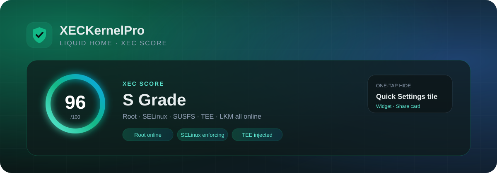

# XECKernel Pro

基于 [KernelSU](https://github.com/tiann/KernelSU) 修改开发的 Android root 方案与管理器：内核级 su、模块系统、App Profile、内置 TEE 引擎与 SUSFS 支持。

<p align="center">
  
</p>

<p align="center">
  <b>Liquid Home · XEC Score · 桌面小组件 · 一键隐藏</b><br>
  <sub>不是换一套图标，而是把“设备现在到底安不安全”做成第一眼就能看到的东西。</sub>
</p>

<p align="center">
  
  
  
  
</p>

## 这次更新：Liquid Home

- **XEC Score**：按 Root、SELinux、SUSFS、TEE 注入、守护组件、LKM、UAPI、稳定版、运行模式实时算分（0–100，S/A/B/C/D），每一项都可解释。
- **动态首页 Hero**：评分环、呼吸光晕、扫描线、守护天数；分数和颜色随状态变化，不再是一张静态玻璃卡。
- **状态卡外观编辑器**：选图、预览、模糊 0–24 dp、压暗 0–65%、一键恢复默认；图片只进应用私有目录。
- **分享设备卡**：本地 Canvas 生成 1080×1440 PNG，带评分/设备/内核/检查项，直接走系统分享。
- **桌面小组件 + 快捷设置磁贴**：桌面看分数，点一下进入现有「一键隐藏」流程；磁贴带状态高亮。
- **入场动效**：启动 Splash 与首页卡片错峰淡入，保留 Liquid Glass 的层次感。

> 这些是当前开发分支的更新，不是一次只改文案的“假更新”。所有代码都在本仓库，构建命令见下文。

## 核心能力

| 能力 | 实现 |
|---|---|
| 内核级 root | KernelSU fork，内核态 su + 模块系统 |
| App Profile | 按 UID 控制 root / umount / 非 root 行为 |
| TEE / TA | 内置或外置引擎，检测页可开关、诊断、修复 |
| SUSFS | 只随 GKI 内核补丁提供，LKM 不提供 |
| Liquid Glass | 全应用玻璃、灵动岛、模块卡 DIY 背景、主题商店/编辑器 |
| XEC Score | Root / SELinux / SUSFS / TEE / 守护 / LKM / UAPI / 稳定性 / 模式 |
| 一键隐藏 | OneTapHide 资源包编排，桌面磁贴/小组件作为入口 |
| 设备卡 | 本地生成，不上传图片或设备信息 |

## 界面结构

```
Home
├── XEC Score hero        score ring / aura / checks / share
├── Status card           root state, LKM/GKI, appearance editor
├── Privilege / Info      GhostLock, device, kernel, SELinux, SUSFS
└── Support links

Detect
├── TEE engine status     injection proof, policy, diagnostics
├── TEE / TA switches     user-selectable, repair path
└── Keybox / checker      local verification

Modules / Repo / Themes
├── module cards          actions, DIY backgrounds, repo source
├── KPM                   KernelPatch module manager
└── theme store           install, edit, publish, live apply
```

## 构建

管理器要求 **JDK 21**、**compileSdk 37.0**、**NDK 29.0.14206865**，并且先把 `ksud` 放到
`manager/app/src/main/jniLibs/arm64-v8a/libxeccli.so`（完整步骤见 `manager/README.md`）：

```bash
cd manager
./gradlew :app:assembleDebug
```

Kernel、LKM、GKI SUSFS 内核均由 `.github/workflows/` 构建；签名密钥只从 Actions Secrets 注入。

## 相关文档

- [使用与安装说明](docs/README_CN.md)
- [挂载态 / <5.10 路线](docs/mount-state-root-guide.md)
- [第三方署名与许可证](THIRD_PARTY_NOTICES.md)
- [更新日志](CHANGELOG.md)

## 许可证与上游归属（License & Attribution）

本项目基于 **tiann/KernelSU** 修改开发，遵守上游原始许可证，并保留上游版权与作者署名：

| 部分 | 许可证 | 说明 |
|---|---|---|
| `kernel/`（内核模块） | GPL-2.0（见 [kernel/LICENSE](kernel/LICENSE)） | 源自 tiann/KernelSU（作者 weishu / tiann 及社区贡献者），上游版权注释（如 `kernel/core/init.c` 的 `MODULE_AUTHOR("weishu")`）予以保留 |
| `manager/`、`userspace/`、`uapi/`、`website/` 等用户态部分 | GPL-3.0（见 [LICENSE](LICENSE)） | 基于 tiann/KernelSU 用户态代码修改开发 |

感谢 KernelSU 及其社区的上游工作。`docs/` 内保留了上游 KernelSU 的原版 README（含 tiann/KernelSU 链接），一并作为归属声明。

### 上游致谢（转引自 KernelSU README「Credits」）

以下条目原样转引自 tiann/KernelSU 的 `docs/README.md`「Credits」节（main 分支，2026-10-06 取）：

- [Kernel-Assisted Superuser](https://git.zx2c4.com/kernel-assisted-superuser/about/): The KernelSU idea.
- [Magisk](https://github.com/topjohnwu/Magisk): The powerful root tool.
- [genuine](https://github.com/brevent/genuine/): APK v2 signature validation.
- [Diamorphine](https://github.com/m0nad/Diamorphine): Some rootkit skills.

### 美术资源

- 应用图标 / Logo：**明风ouo**（依 CC 协议授权使用，在此致谢）

### 源码合编译与 GPL-2.0 单独致谢

- 内置模块（TEESimulator-RS、Tricky Addon Enhanced）为 **GPL-3.0 源码合编译**：
  上游源码原样 vendor 在 [`third_party/`](third_party/)（每目录附 `UPSTREAM.md`
  注明仓库 / 作者 / 固定 commit / 许可证），CI 从源码构建全部引擎二进制，
  仓库与发布渠道不携带任何 GPL 预编译二进制。
- **GPL-2.0 上游**（KernelSU 内核模块、simonpunk/susfs4ksu 内核补丁、AnyKernel3 等）
  在 [THIRD_PARTY_NOTICES.md](THIRD_PARTY_NOTICES.md) 的
  「GPL-2.0 上游致谢」一节单独列出致谢。
- **协议合规**：GPL-3.0 §4/§5/§6/§7 各项义务（保留声明、修改声明与日期、整体同许可、
  提供对应源码、不加附加限制）的实际履约方式，以及 LGPL-3.0 / Apache-2.0 / MIT 的
  履约要点，见 [THIRD_PARTY_NOTICES.md](THIRD_PARTY_NOTICES.md) 的
  「开源协议合规」一节；上游文件头与各模块 `NOTICE.md` 均带修改声明与日期。

第三方组件与内置/分发模块的完整致谢与许可证清单见 [THIRD_PARTY_NOTICES.md](THIRD_PARTY_NOTICES.md)；应用内「关于 → 开发者名单 → 致谢」同样列有上游致谢。

## 构建

- 管理器 APK、内核 LKM、GKI SUSFS 内核均由 GitHub Actions 构建（`.github/workflows/`）。
- 发布签名密钥通过仓库 Actions Secrets（`SIGN_KEYSTORE_B64` / `SIGN_STORE_PASS` / `SIGN_KEY_PASS`）注入 CI，不随仓库分发。

## 相关链接

- 上游项目：https://github.com/tiann/KernelSU
- 问题反馈：本仓库 Issues
- 5.10 以下内核（挂载态 / Magisk 路线）使用指南：[docs/mount-state-root-guide.md](docs/mount-state-root-guide.md)
