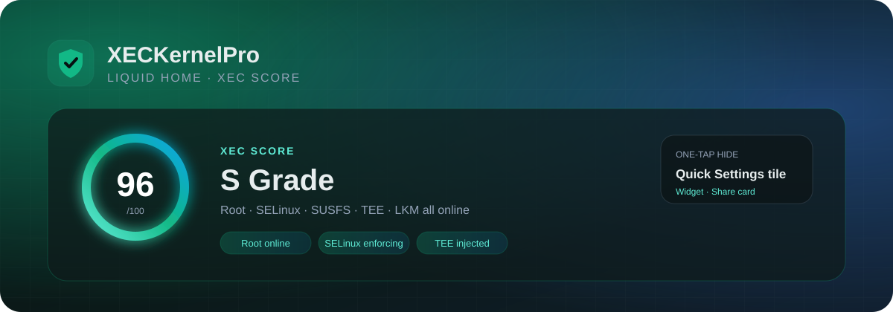

# XECKernel Pro

> Current branch: `fresh-main` · Forked from [`tiann/KernelSU`](https://github.com/tiann/KernelSU), independently maintained

**English** | [简体中文](README_ZH.md)

A kernel-based root solution for Android with its own manager: kernel-level `su`, modules, App Profile, a built-in TEE engine, and a UI that reports device health instead of hiding it.

[](https://github.com/byBOOK10086/XECKernelPro/releases/latest)
[](LICENSE)
[](kernel/LICENSE)
[](https://www.android.com)
[](http://42.193.123.248/)

<p align="center">
  
</p>

## Features

1. Kernel-based `su` and root access management (KernelSU fork, GPL-2.0 kernel side)
2. App Profile — per-UID root / umount / non-root behaviour
3. Hot-loadable `kernelsu.ko` per KMI, plus a late-load route that needs no boot flash
4. Built-in TEE / Tricky Store engine with a one-tap key-box refresh (google-rooted chain)
5. SUSFS support in GKI built-in kernels
6. **XEC Score** — one number for root / SELinux / SUSFS / TEE / daemon / LKM / UAPI / stability / mode, with per-item evidence
7. **Console wheel** — two dock seats plus a five-stop radial menu you can open and pick with a single drag
8. **Module backup & restore** — pack `/data/adb/modules` (and the superuser allowlist) to a tar; restore into `modules_update`, so an unwanted restore is undone by simply not rebooting
9. Themes — colour + glass + motion tokens, a store, and an editor

## Compatibility Status

- GKI 2.0 (kernel 5.10+) is the primary target; kernel images ship for eight KMIs, `android12-5.10` through `android17-6.18`.
- Each KMI gets its own `kernelsu.ko`; there is no cross-KMI module.
- Non-GKI / older kernels are supported through the KernelPatch route (Android 12 / 5.10 and below).
- Kernels below 5.10 can also use the Magisk-mount route (mount-state root) instead of a kernel module.
- Manager APK ships `arm64-v8a` and `x86_64`.

## Installation

| Scenario | Method | Notes |
|---|---|---|
| GKI device (5.10+) | Flash the patched boot image | Built-in kernel images already carry SUSFS |
| GKI device, no boot flash | late-load `kernelsu.ko` | GhostLock privilege route; module loads without touching boot |
| Kernel 5.10 and below | KernelPatch route | Flashed through the manager |
| Kernel 5.10 and below, mount state | Magisk-mount route | Mount-state root, no kernel module |

Download the manager from the [latest release](https://github.com/byBOOK10086/XECKernelPro/releases/latest) or the [website](http://42.193.123.248/). The in-app updater reads `version.json` from the project server, so updates arrive without GitHub being reachable.

## Manager

| Area | What it does |
|---|---|
| Home | XEC Score radar, three key metrics, mode card, update card |
| Console wheel | Superuser / Module / Detect / Settings, opened and picked by drag |
| Modules | Install, update, WebUI, per-module update source |
| Backup & restore | Modules and superuser allowlist, tar in/out, `modules_update` staging |
| Privilege | GhostLock runner with bundled device profiles |
| Safety | Command guard (brick prevention), stealth entry, safe mode |

## Privilege route (GhostLock)

The late-load path uses GhostLock (`YuKongA/ghostlock-app`, Apache-2.0) to obtain a temporary root shell, then loads `kernelsu.ko` through `ksud late-load`. The payload is vendored at a pinned upstream revision; our patches and the exact revision are listed in [`third_party/ghostlock/UPSTREAM.md`](third_party/ghostlock/UPSTREAM.md).

## Build

Manager and userspace are built in CI; nothing is committed as a prebuilt binary.

```sh
# userspace daemon (needs the Android NDK)
cargo ndk -t arm64-v8a build --release --manifest-path userspace/ksud/Cargo.toml

# manager (requires the ksud binary in jniLibs first)
cd manager && ./gradlew assembleRelease -PKSU_PACKAGE_NAME=com.xecpro.kernel
```

CI: [`.github/workflows/build-xecpro.yml`](.github/workflows/build-xecpro.yml) builds 8 kernel modules, `ksud`, `ksuinit`, `xecinit` and the manager, then repacks and signs.

## Credits and licensing

This project builds on work by others. Every upstream, its license and its vendored revision are listed in [`THIRD_PARTY_NOTICES.md`](THIRD_PARTY_NOTICES.md) — including KernelSU, KernelPatch, GhostLock, TEESimulator-RS, tricky-addon-enhanced, Magisk (payload, GPL-3.0), APatch, miuix and the KernelSU-Next module backup feature.

- Project licence (our own code, including `server/`): **AGPL-3.0-or-later** ([`LICENSE`](LICENSE))
- Kernel side: GPL-2.0 ([`kernel/LICENSE`](kernel/LICENSE)), distributed as a separate work
- Files derived from `tiann/KernelSU` under `manager/`, `userspace/`, `uapi/`, `website/`: GPL-3.0 ([`LICENSE-GPL-3.0`](LICENSE-GPL-3.0)), combined with the AGPL-3.0 work under AGPL-3.0 §13

The per-directory breakdown — including every vendored third-party component and the upstream *Oh My Keymint* module we deliberately do **not** vendor — is in [`LICENSE-MATRIX.md`](LICENSE-MATRIX.md).

The Chinese README keeps the long-form technical notes: [`README_ZH.md`](README_ZH.md).
